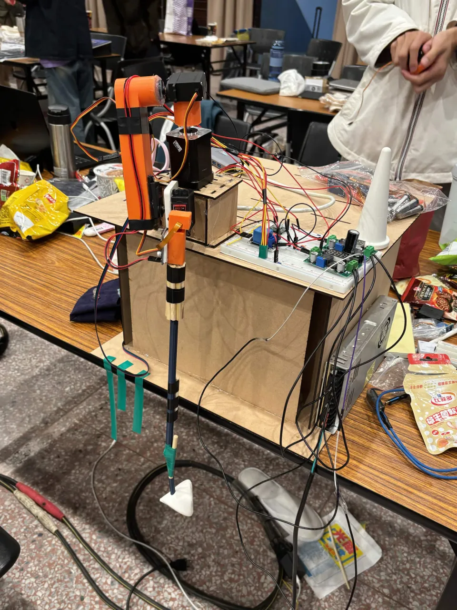
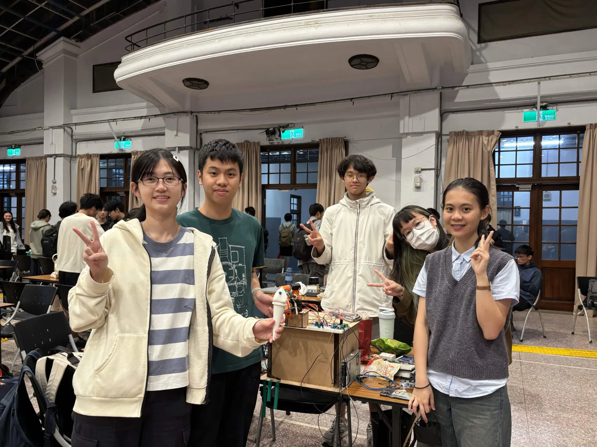

# 🍦 Turkish Ice Cream

> Interactive kiosk-style demo stack — perception, motion, and HTTP API.

A lightweight **Turkish ice cream project** that combines a **FastAPI** core service, library packages for **hand tracking** and **motor / hardware adapters**, and a **Poetry + pyenv** workflow ready for Raspberry Pi or desktop development.

[View MakeNTU presentation slides](./docs/MakeNTU26.pdf)

<p align="center">
  
</p>



<!-- Optional: add screenshots under `./assets/` and uncomment.

-->

---

## ✨ Features

- blablabla

---

## 📋 Prerequisites

| Tool       | Version | Purpose                                |
| ---------- | ------- | -------------------------------------- |
| **Git**    | ≥ 2.30  | Clone the repository                   |
| **pyenv**  | ≥ 2.3   | Manage local Python versions           |
| **Python** | 3.12.x  | Runtime (pinned via `.python-version`) |
| **Poetry** | ≥ 2.1   | Dependencies & virtual environment     |

Optional: hardware targets (e.g. Raspberry Pi) depend on how you deploy `motor_adapter` — wire them in your integration layer, not required for running the API locally.

---

## 🚀 Quick Start

### 1 Clone the repository

```bash
git clone git@github.com:work-tomorrow/turkish-ice-cream.git
cd turkish-ice-cream
```

### 2 Install pyenv

<details>
<summary><b>macOS (Homebrew)</b></summary>

```bash
brew update
brew install pyenv
echo 'eval "$(pyenv init -)"' >> ~/.zshrc
source ~/.zshrc
```

</details>

<details>
<summary><b>Ubuntu / Debian</b></summary>

```bash
curl https://pyenv.run | bash
echo 'export PATH="$HOME/.pyenv/bin:$PATH"' >> ~/.bashrc
echo 'eval "$(pyenv init -)"' >> ~/.bashrc
source ~/.bashrc
```

</details>

### 3 Install & pin Python (matches `.python-version`)

```bash
pyenv install 3.12.3    # skip if already installed
pyenv local   3.12.3   # writes .python-version
python --version       # should print Python 3.12.x
```

### 4 Install Poetry

```bash
curl -sSL https://install.python-poetry.org | python3 -
echo 'export PATH="$HOME/.local/bin:$PATH"' >> ~/.bashrc   # or ~/.zshrc
source ~/.bashrc
poetry --version
```

### 5 Install dependencies

```bash
poetry env use "$(pyenv which python)"   # bind Poetry’s venv to pyenv’s Python
poetry install                           # creates .venv + installs packages
poetry run pip install mediapipe         # only on devices running vision_service
```

---

## 🛠 Start Core API

Run this on the Raspberry Pi. The core API owns motors, sessions, and the
RPI-side system status. It receives hand detection results from the desktop
vision service over `ws://<rpi-ip>:8000/ws/hand-ingest`.

```sh
eval "$(poetry env activate)"
cp core/.env.example core/.env
poetry run python -m core
```

## 🖥 Start Desktop Vision Service

Run this on the computer with the camera / MediaPipe hand detection workload.
The service keeps the camera preview local and pushes `HandDetectionResult`
messages out to the RPI, so the computer does not need to accept inbound
connections through its firewall.

MediaPipe is intentionally not managed by Poetry. Install it into the active
Poetry environment on the desktop machine:

```sh
poetry run pip install mediapipe
```

```sh
eval "$(poetry env activate)"
cp vision_service/.env.example vision_service/.env
poetry run python -m vision_service
```

Set `RPI_HAND_INGEST_WS_URL` in `vision_service/.env` to the RPI core ingest endpoint:

```env
RPI_HAND_INGEST_WS_URL=ws://<rpi-ip>:8000/ws/hand-ingest
```

The desktop service listens on `http://localhost:8010` by default and exposes:

| Method | Path             | Purpose                                      |
| ------ | ---------------- | -------------------------------------------- |
| GET    | `/ping`          | Check whether the vision service is reachable. |
| GET    | `/hand`          | Return the latest full hand detection result. |
| GET    | `/vision/frame`  | Return the latest annotated frame. |
| GET    | `/vision/stream` | Stream annotated frames as MJPEG. |

For the demo web, copy `web/.env.example` to `web/.env`. Keep
`VITE_API_BASE_URL` pointed at the RPI core API and set
`VITE_VISION_API_BASE_URL` to the desktop vision service for the camera preview.

The core service no longer serves `/vision/frame`; camera preview routes live in
the desktop vision service.

### Motor Runtime Profile

The core service reads `core/.env`. Use `TURKISH_ICE_CREAM_MOTOR_PROFILE` there
to choose its motor runtime. The default is `mock`, so local development never
touches Raspberry Pi GPIO by accident. Set it to `hardware` on the RPI deployment:

```env
TURKISH_ICE_CREAM_MOTOR_PROFILE=hardware
```

Invalid profile values fail at startup. Hardware startup errors also fail directly
instead of silently falling back to mock motors.

### Motors API

The core service exposes motor state and calibration controls under `/motors`:

| Method | Path                    | Purpose                                      |
| ------ | ----------------------- | -------------------------------------------- |
| GET    | `/motors`               | List each motor's current angle, limits, and jog step size. |
| POST   | `/motors/{motor_id}/jog`  | Jog one motor in the `positive` or `negative` direction. |
| POST   | `/motors/{motor_id}/zero` | Treat one motor's current position as zero degrees. |
| POST   | `/motors/zero`          | Treat all motors' current positions as zero degrees. |

Example jog request:

```json
{
  "direction": "positive",
  "step_degrees": 3
}
```

### Status API

`GET /status` returns the RPI-side runtime status without demo counters. The
`vision` section shows the latest hand result that the RPI has received from the
desktop vision service:

```json
{
  "system": {
    "ready": true
  },
  "robot": {
    "state": "idle"
  },
  "vision": {
    "hand_detected": false,
    "hand": {
      "detected": false,
      "x": null,
      "y": null,
      "confidence": null
    }
  }
}
```

`robot.state` is one of `idle`, `started`, `stopping`, or `error`. `DELETE /session` is the single stop command: it stops the current interaction and immediately stops all motors.

### Other Commands

| Goal                      | Command                            |
| ------------------------- | ---------------------------------- |
| Sync dependencies         | `poetry install`                   |
| Add a runtime dependency  | `poetry add <package>`             |
| Add a dev-only dependency | `poetry add --group dev <package>` |

---

## 📜 License

Distributed under the **MIT License**. See [`LICENSE`](LICENSE) for details.
